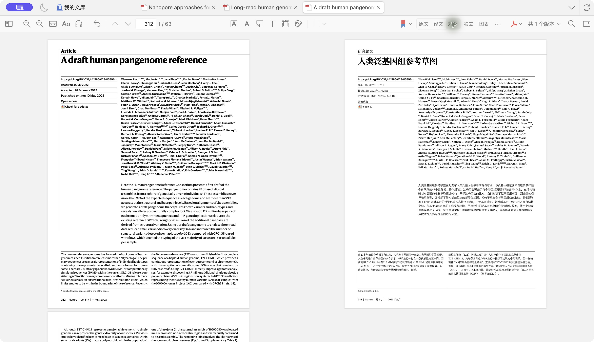
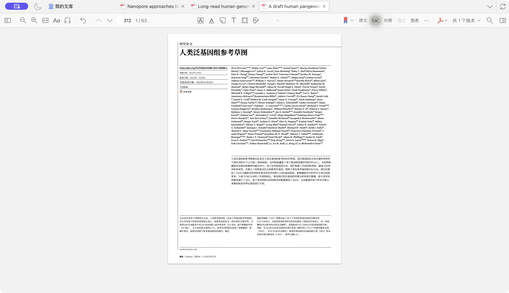
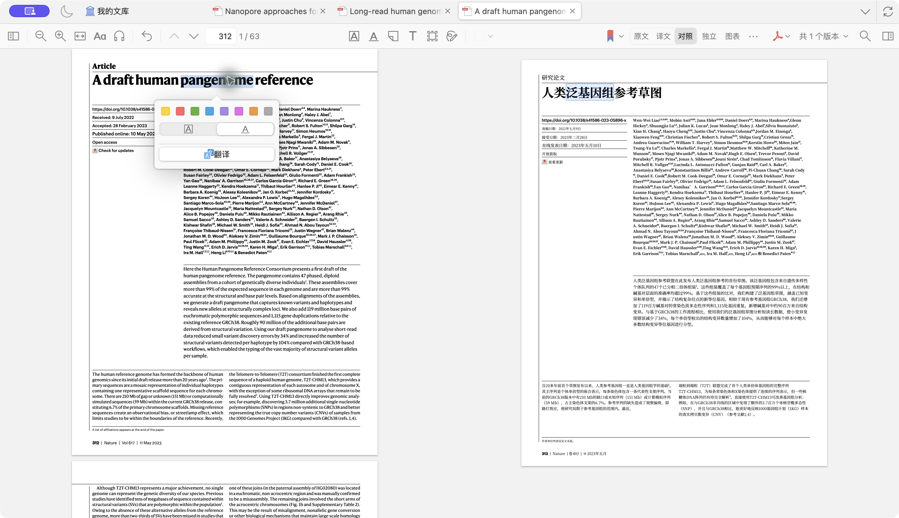
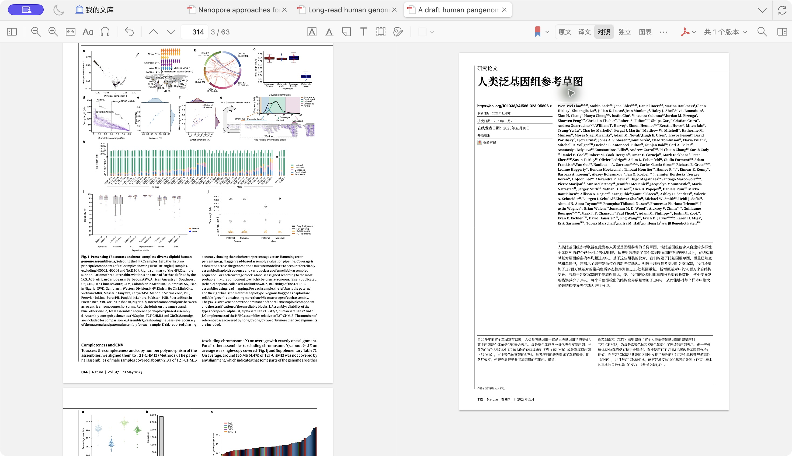
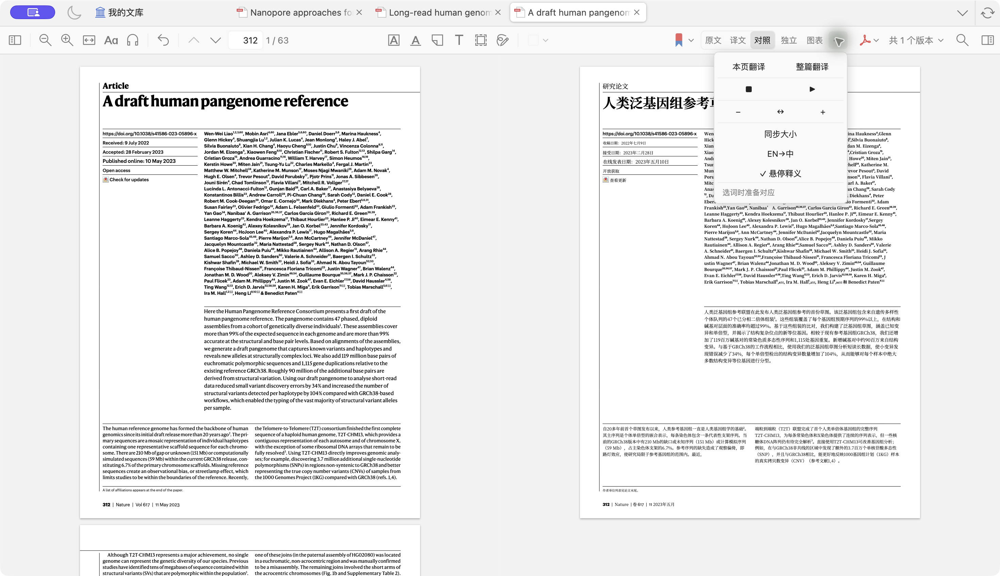
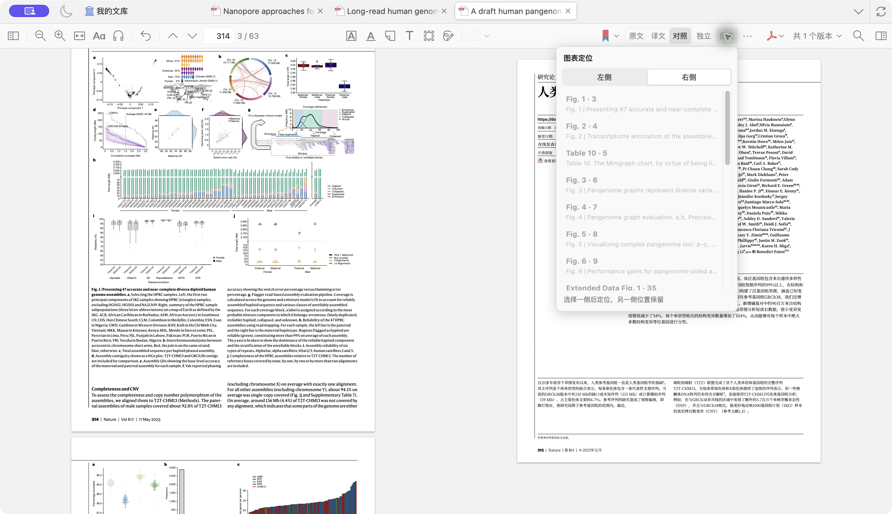
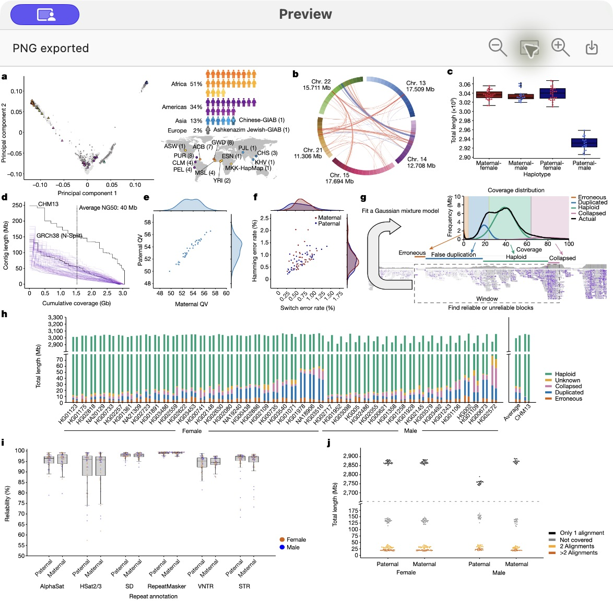

<div align="center">

**[中文](README.md) · English**


# 📖 Ask for GPT

**Read the paper. Switch fewer windows.**

Look up words, ask about a passage, and read web pages and PDFs in two languages. Keep your reading notes in Zotero, then refine your wording as you write.

[](https://github.com/Woyekun-cell/Ask-for-GPT/releases/download/v1.1.55/Ask-for-GPT-1.1.55-macOS-arm64.dmg)
[](https://github.com/Woyekun-cell/Ask-for-GPT/releases/download/v1.1.55/Ask-for-GPT-1.1.55-macOS-arm64.zip)

[](https://github.com/Woyekun-cell/Ask-for-GPT/releases/download/v1.1.38/Ask-for-GPT-0.1.0-preview.1-Windows-x64-Setup.exe)

**macOS v1.1.55 · Apple Silicon · macOS 15+ | Windows x64 v0.1.0-preview.1**

[macOS setup (中文)](docs/INSTALL.macOS.zh-CN.md) · [Windows setup (中文)](docs/INSTALL.Windows.zh-CN.md) · [Zotero guide (中文)](docs/ZOTERO.zh-CN.md) · [Translation backends (中文)](docs/TRANSLATION-BACKENDS.zh-CN.md) · [Interface gallery](docs/GALLERY.md) · [Releases](https://github.com/Woyekun-cell/Ask-for-GPT/releases) · [Issues](https://github.com/Woyekun-cell/Ask-for-GPT/issues)

</div>

Ask for GPT comes in Windows and macOS versions, bringing word lookup, passage-based questions, and bilingual web and PDF reading together while keeping annotations and notes in Zotero. The macOS version also provides Word/WPS writing assistance. I continue to develop it around the practical needs of reading and academic writing.

The app works where you already read and write: your Zotero attachment and annotations, the page open in Chrome, or a manuscript in Word. English word lookup uses a local dictionary. In macOS 1.1.55, AI features use your own ChatGPT login session through Codex.

## Download and install

macOS 1.1.55 fixes translated-reader theme inheritance, fits both panes with Fit Width, and hides a finished correspondence indicator while preserving existing translations, caches, and annotations. The Windows assets retain the independently validated `0.1.0-preview.1` build (source `05348ad`); these new macOS reader features are not claimed for that Windows binary.

**Windows version (x64):** [Windows installer and portable ZIP](https://github.com/Woyekun-cell/Ask-for-GPT/releases/tag/v1.1.38) · [Setup guide (中文)](docs/INSTALL.Windows.zh-CN.md). Provides selection lookup, an offline dictionary, passage translation and questions, Chrome/Zotero reading integration, bilingual PDFs, and configurable translation backends. [Build and check records](https://github.com/Woyekun-cell/Ask-for-GPT/actions/workflows/windows-preview.yml) are available in the workflow. The interface examples below use the macOS version.

Choose a macOS installer above to start using the app. The macOS application itself is about **48 MB**, including roughly 400,000 English dictionary entries, the Chrome and Zotero integrations, and writing integration resources.

| Download | How to use it |
| --- | --- |
| [DMG installer](https://github.com/Woyekun-cell/Ask-for-GPT/releases/download/v1.1.55/Ask-for-GPT-1.1.55-macOS-arm64.dmg) | Recommended. Open the disk image, drag the app to Applications, and follow the included setup instructions |
| [ZIP archive](https://github.com/Woyekun-cell/Ask-for-GPT/releases/download/v1.1.55/Ask-for-GPT-1.1.55-macOS-arm64.zip) | Extract and install; contains the same app and setup scripts |
| [Source code](https://github.com/Woyekun-cell/Ask-for-GPT/archive/refs/heads/main.zip) | Build the app, inspect the implementation, or adapt an integration; see the [developer handbook](docs/HANDBOOK.zh-CN.md) |

First setup on macOS takes four steps:

1. **Install the app.** Move Ask for GPT into Applications and open it. This release is not notarized by Apple. If macOS blocks the first launch, follow its confirmation in System Settings → Privacy & Security.
2. **Configure the model connection.** The default route is the included **`01-登录ChatGPT.command`**. It unpacks and verifies official Codex CLI 0.163.0, then opens browser sign-in. Copy its CLI path into settings, click **保存并连接** (save and connect). No npm or Homebrew installation is needed. This Mac binary uses Codex.
3. **Prepare PDF translation when needed.** Run **`02-准备PDF翻译.command`** to download pinned uv, Python 3.12.15, prebuilt dependencies, and the public fonts and models used for layout. This one-time preparation needs internet access and about 1 GB of local storage, with no compilation. Everyday PDF translation still needs a network connection for model requests.
4. **Connect your reader.** Open **页面内翻译…** from the app's menu bar to install the Zotero add-on or load the Chrome extension.

The [macOS installation guide](docs/INSTALL.macOS.zh-CN.md) covers these steps, permissions, and common problems. The local English dictionary works offline.

### Model connection in this build

The **macOS 1.1.55 binary uses Codex**. Enter the signed-in Codex CLI under **CLI 路径** (CLI path), then select **保存并连接** (save and connect). The API / Claude adapters described in earlier public source snapshots are not included in this macOS binary. See the [backend notes](docs/TRANSLATION-BACKENDS.zh-CN.md) for historical and Windows configuration scope.

### One-minute narrated demo

[Watch real Zotero operations with English synthetic narration](https://github.com/Woyekun-cell/Ask-for-GPT/releases/download/v1.1.55/Ask-for-GPT-1.1.55-Zotero-demo-en.mp4). The video shows shared reading themes, Fit Width for both panes, and cached view switching. [Capture details and scope](docs/GALLERY.md#reader-demo-155).

## Read a paper closely in Zotero

### Start with one page, then translate the document

Open a PDF in Zotero. The **PDF 翻译** sidebar offers scope, view, and language direction. Start with **当前页** (current page), **中英对照** (side by side), and **EN → 中** to read an abstract or key result. When the paper is relevant, choose **整篇** (whole document) to continue. **中 → EN** is also available for Chinese documents.



*Zotero bilingual reading · Liao et al., [A draft human pangenome reference](https://doi.org/10.1038/s41586-023-05896-x) (Nature, 2023; [CC BY 4.0](https://creativecommons.org/licenses/by/4.0/)). Ask for GPT generated and typeset the Chinese machine translation on the right.*

The translation appears in the existing attachment tab. Progress stays visible in the sidebar and toolbar while you read the original or switch to another paper. Each document has its own task; up to two can run at once and can be stopped separately.

### Switch between the original, translation, and side-by-side views

The toolbar offers **原文 / 译文 / 对照**: original, translated, and side by side. Translated text is laid out within the PDF pages, preserving the relationship between text, figures, and tables. Side-by-side mode uses two native PDF panes, with the original on the left and the translation on the right.



Use the translated view to follow a section, then switch to side by side for a term, equation, or important conclusion. View changes reuse completed results. The original attachment keeps its identity and reading progress.

### Select a phrase and find its counterpart

Select words in either pane to see an established counterpart in the other language. You can move from English to Chinese or use the translation to find the original wording. This helps with terminology, verb choices, and modifiers in context.



*Live capture: “pangenome” and “泛基因组” are selected in their respective panes, with Zotero’s native color palette open. This is a temporary selection; no annotation was saved for the capture.*

Phrase mapping accounts for differences in word length and order. Where a reliable link exists, part of a Chinese selection can correspond to a complete English word while retaining the Chinese range you actually selected. Ordinary text selection does not automatically create an annotation, so you can look up or copy a phrase as you read.

Enable **悬停释义** (hover gloss) in the sidebar for quick word lookup while reading. For a longer passage, select it and press **`⌥D`** to open the reading panel.

### Keep reading notes with Zotero's eight native colors

After selecting text, use Zotero's native eight-color popup to save a highlight or underline. A mark made on the translated side is associated with the corresponding original PDF text and retains the translated excerpt. You can continue adding comments, changing colors, and navigating from Zotero's annotation list.

Saved marks are projected again when you return to the original or reopen the side-by-side view. Organize questions, methods, evidence, and conclusions using your own color scheme.

### Scroll together or keep one pane in place

**联动** (linked) scrolling follows your reading position from either pane. Switch to **独立** (independent) to leave one pane on the results while checking a method or definition in the other. Turn linked scrolling back on to align from the side you are reading.



*The original Fig. 1 remains on the left; the completed Chinese first page stays on the right. Paper attribution as above.*



Use **⋯ → 同步大小** (match pane zoom) when the panes have different scales. The More menu also provides current-page and whole-document translation, stop, retry, zoom, and fit width. You can keep reading while phrase correspondence is being prepared; with a completed translation, retry prioritizes missing correspondence information.

**Option-click** a paragraph to focus on the passage you are reading.

### Open a figure in one pane and keep the results in the other

The **图表** (figures and tables) button opens an index with labels, page numbers, and caption excerpts. Choose the left or right pane, then select an entry. That pane jumps to the figure while the other stays where it was—useful when a results paragraph refers to Fig. 3.



A figure jump switches scrolling to independent mode. Restore linked scrolling when you are ready to continue. The caption index is reused within the current PDF session. Completed translations are stored locally for longer-term reuse, matched by document content, page range, language direction, translation revision, and a backend configuration digest. A completed whole-document result can also supply an individual page.

Click a figure, or hover over it and press **Space**, to open an independent preview. Zoom in to inspect labels, fit the image to the window, or export it as a PNG.



*Live Fig. 1 preview from the same paper. Zoom, Fit and Export PNG were exercised; “PNG exported” is the actual success status. [Preview and zoom examples](docs/GALLERY.md#独立放大图片并导出-png).*

### Return to your reading position

Enable **重开时提示阅读位置** in the PDF translation sidebar to receive a reading-position prompt when you reopen the paper. A completed local whole-document translation can be matched to its source and reused, or imported as a regular PDF attachment for separate reading.

See the **[Zotero reading guide](docs/ZOTERO.zh-CN.md)** for detailed controls, background tasks, and annotations.

## Look up a word without leaving your reading

Select text in an app that exposes its selection and press **`⌥D`** to open the translation panel. Single words use the local dictionary first, with pronunciation, parts of speech, meanings, and inflections. The macOS panel offers three ways to read a passage:

| Tab | Use it for |
| --- | --- |
| **Local** | Apple on-device translation of the selected text |
| **GPT** | A closer translation of the selected passage |
| **Explain** | The selected passage's terminology, reasoning, and qualifications |

**GPT** and **Explain** start a model request when you click them. Use **Stop / Retry** to control a request.


Choose **EN → 中** or **中 → EN** for the language direction. **Auto** detects the source language and translates into Chinese. Expand the original to compare wording, select result text and copy it with the system shortcut, or adjust the text color. You can also paste text into **Paste text** and click **Translate**. Enable automatic selection translation for continuous reading, or use the shortcut when needed.

## Ask a specific question with the passage attached

Choose **Ask GPT** in the reading panel, or select a difficult sentence and press **`⌥X`**. The passage becomes context for your question. Ask what a condition refers to, how a term relates to the previous paragraph, or how the sentence is structured. Replies stream into the panel, and you can follow up without copying the passage again.

Questions can also use web search and source links when you need supporting material. Press **Enter** to send and **Shift+Enter** for a new line.

## Follow translations on the original web page

Use the Chrome extension button or **`⌥⇧X`** to insert translations paragraph by paragraph, with the original above and translation below. Translation starts near the current viewport and continues as you scroll. The reading controls provide language direction, text color, **Pause translation / Resume translation**, and **Restore original**.

Chrome PDFs use a layout-preserving reader in the current tab, with **Page / Document** range and **Translation / Original + Translation / Original** display options. The toolbar keeps page numbers, language direction, progress, **Translate**, and **Cancel** together. Local PDFs require file URL access in the extension settings; see the [installation guide](docs/INSTALL.macOS.zh-CN.md).

On macOS, the **PDF · 原阅读器** menu supports PDFs open in Preview or WPS. Choose current-page or whole-document translation, translation-only or bilingual output, and either language direction. The generated PDF opens in the original reader; the menu also offers the most recent translation, a return to the original PDF, and cancellation.

## Review writing suggestions before applying them

The Word integration provides spelling checks and GPT writing suggestions. The suggestion card shows the original and revision together, with actions to replace, ignore, or add to the dictionary. Choose minimal edits or clearer expression, and set US or UK spelling preferences.


Reading and writing share the same app settings, making it easy to move from understanding a paper to expressing your own ideas. Word/WPS add-ins require additional local connection and HTTPS setup, covered in the [developer handbook](docs/HANDBOOK.zh-CN.md#5-word--wps-写作加载项). WPS offers explicit checking in a sidebar; its current scope is listed below.

## Settings and shortcuts

In macOS 1.1.55, set **CLI 路径** (CLI path), the question model, and reasoning effort, then select **保存并连接** (save and connect). The settings screenshot below is retained from an earlier version; its optional translation configuration does not describe this Mac binary.


| Default shortcut | Action |
| --- | --- |
| `⌥D` | Translate selected text; configurable |
| `⌥X` | Ask about selected text |
| `⌥⇧X` | Translate or restore a page in Chrome / Zotero |
| `⌘,` | Open settings |
| `Enter` / `Shift+Enter` | Send / new line in questions |

## Compatibility and data handling

| Component | Current scope |
| --- | --- |
| macOS version | Apple Silicon Mac; the full PDF environment requires macOS 15+; this release is not Apple-notarized |
| Windows version | Windows x64; selection lookup, translation, questions, and Chrome/Zotero bilingual PDFs; see the [Windows guide (中文)](docs/INSTALL.Windows.zh-CN.md) for setup and platform scope |
| Apple on-device passage translation | macOS 26+ with the relevant language packs |
| AI connections | Codex CLI uses ChatGPT sign-in by default; alternative translation routes use their own service configuration, while questions and writing stay on Codex |
| Zotero | Zotero 9.x; PDF translation requires the included PDF setup step |
| Chrome | Chrome 106+; local PDFs require file URL permission |
| PDF content | Requires a text layer; scans need OCR first, and image text stays unchanged; complex vertical figure text may lack exact phrase correspondence |
| Word / WPS (macOS) | Word offers inline suggestions; WPS currently uses explicit sidebar checks without inline colored underlines, and replacement and undo need testing in the target host version |

Dictionary lookup and Apple translation run on your device. In the macOS 1.1.55 binary, AI translation, sentence/phrase mapping, questions, and writing send relevant text and necessary context through your Codex connection. The Windows preview retains its separately documented backend options. PDF extraction and layout run locally. Use content you have permission to submit to the selected service.

Original PDFs are preserved. Manually saved Zotero annotations belong to the original attachment. Completed translations remain stored locally, while unfinished working files have separate cleanup rules. Check terminology, numbers, equations, and meaning before quoting a translation. Physical modifier-wheel gestures, displayed frame rates, and a complete fresh-Mac installation still need further live testing.

Sources for the reading interface and feature demonstrations are linked in the [interface gallery](docs/GALLERY.md).

## Source and development

The app uses Swift, AppKit, and SwiftUI. Sources for the reading integrations, writing integrations, and PDF engine are included.

```text
Sources/       macOS app and core logic
Integrations/  Chrome, Zotero, Word/WPS, and the PDF engine
Resources/     Icons, local dictionary, and writing rules
Tests/         Swift core tests
scripts/       Build, install, package, and check tools
docs/          Guides, interface sources, and release manifest
```

See the [developer handbook](docs/HANDBOOK.zh-CN.md) to build the app, run tests, or configure a development environment. Public file checksums are listed in the [release manifest](docs/release-manifest.json).

The local dictionary comes from [ECDICT](https://github.com/skywind3000/ECDICT); PDF layout integration uses [BabelDOC](https://github.com/funstory-ai/BabelDOC). Component licenses, pinned versions, and source notices are retained in [NOTICE](NOTICE.md).

Please report problems through [Issues](https://github.com/Woyekun-cell/Ask-for-GPT/issues), with your system, host and extension versions, reproduction steps, and screenshots without private content.
