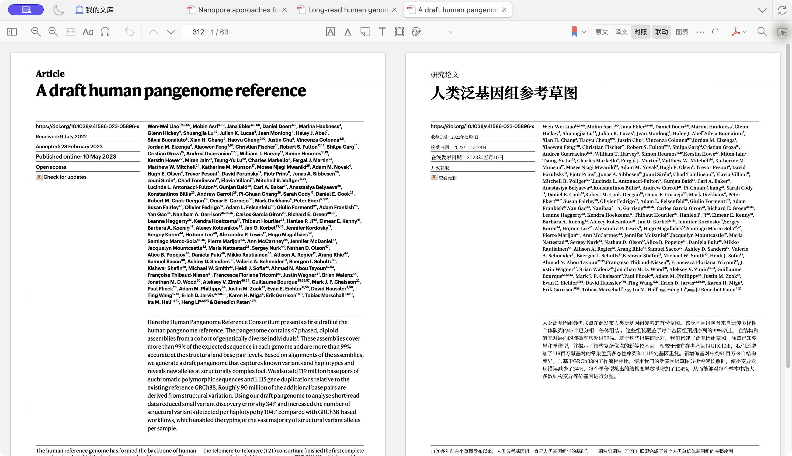
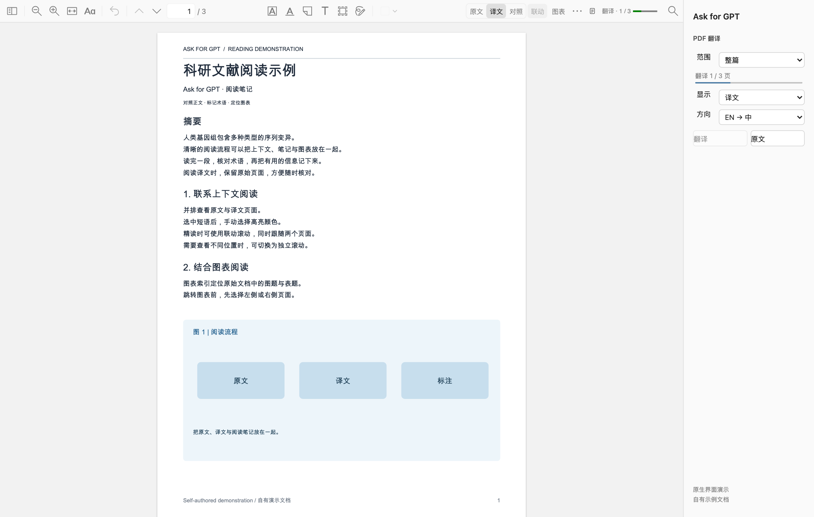
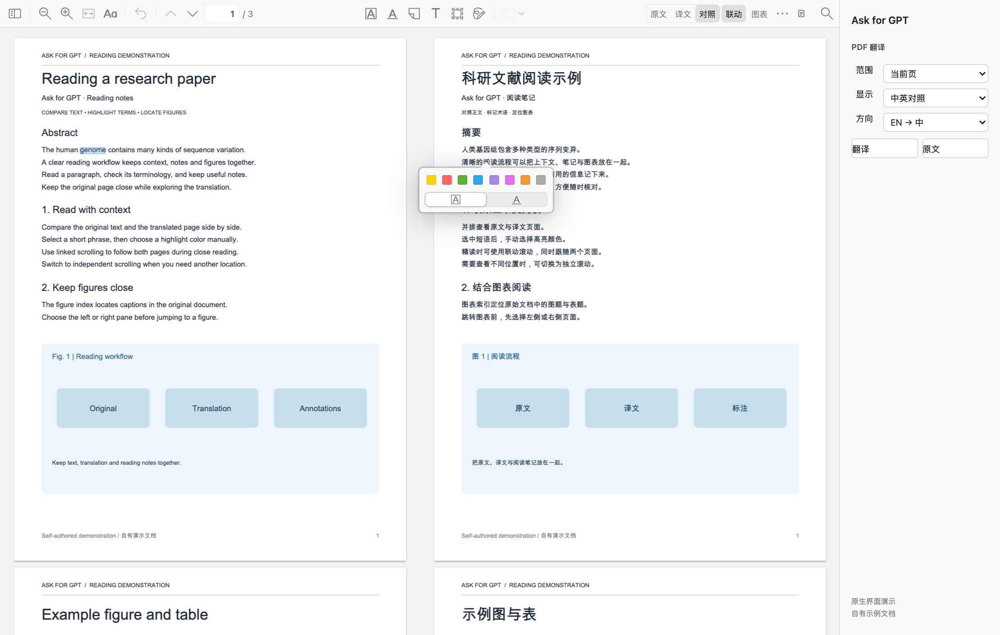
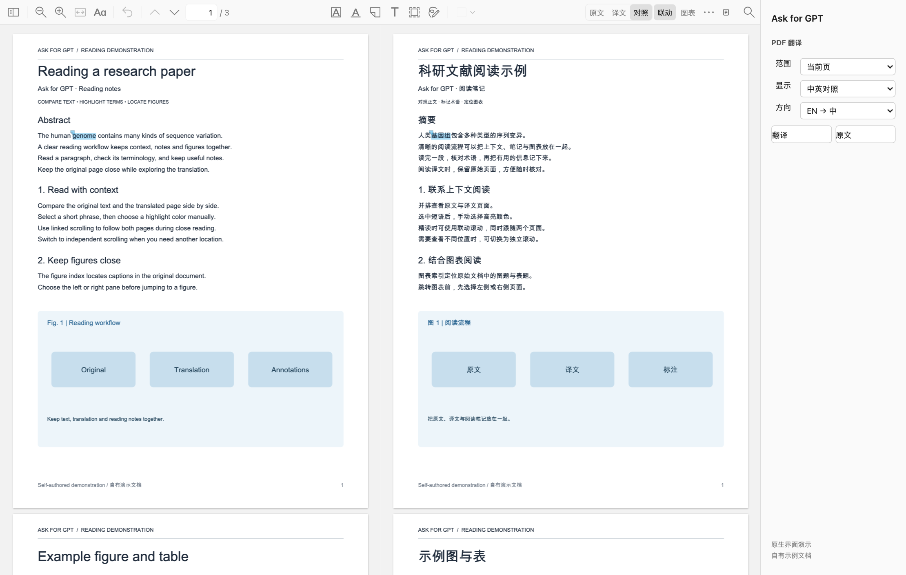
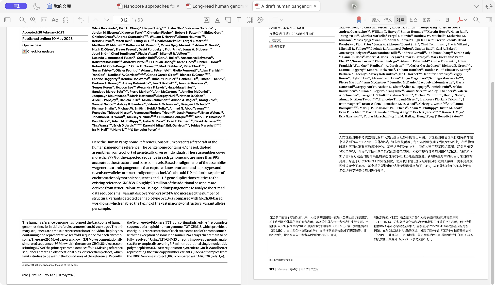
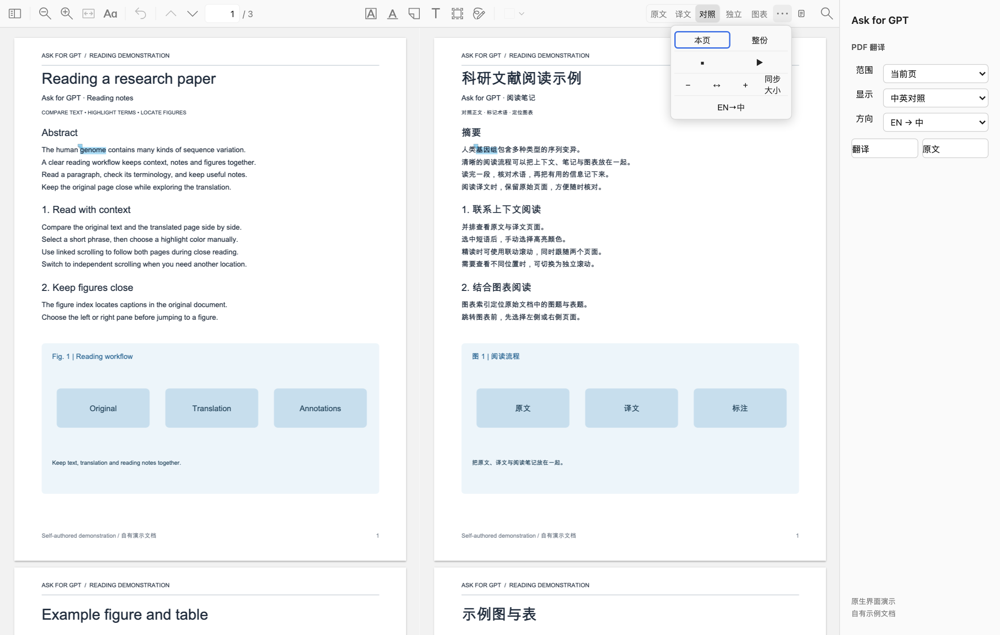
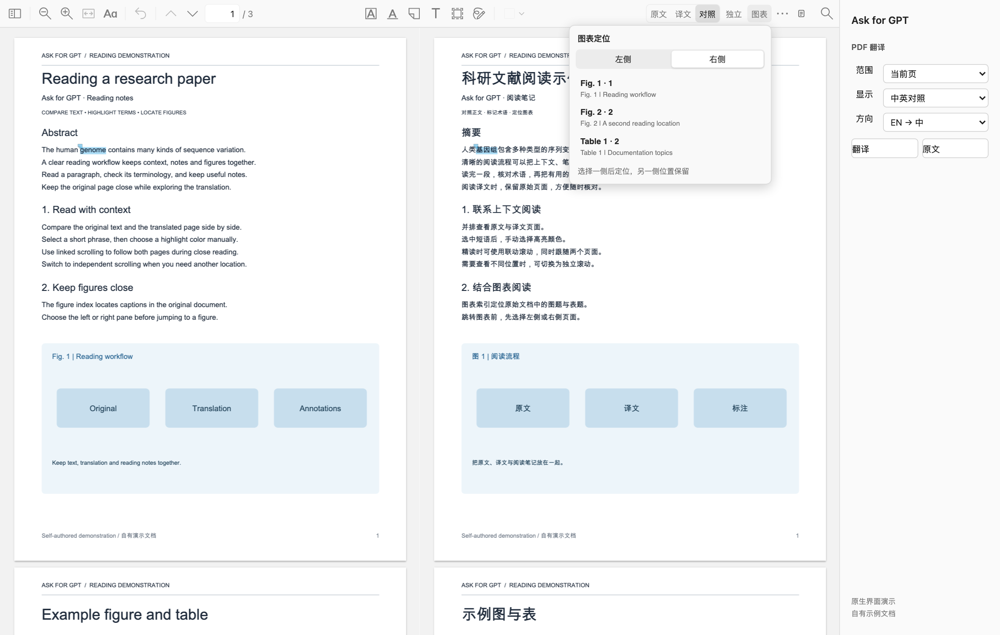
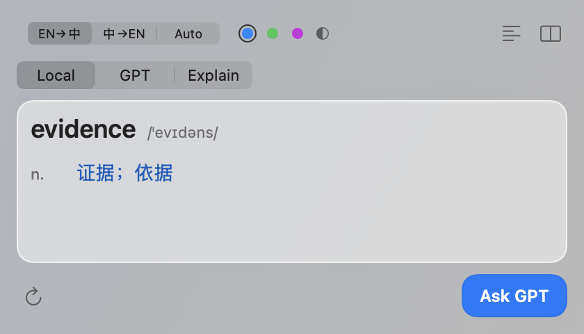
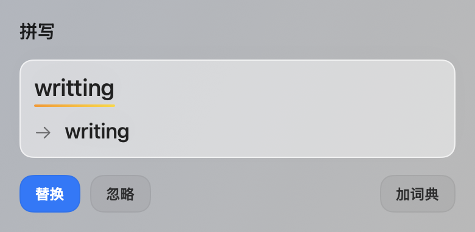
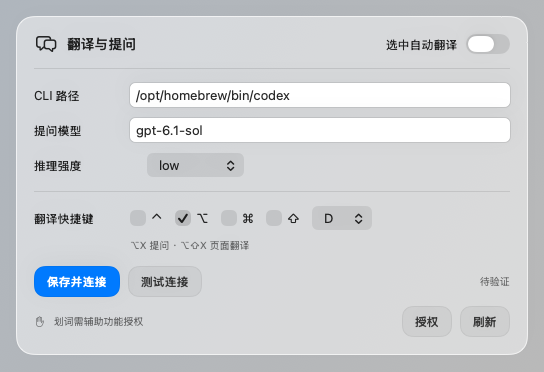

<div align="center">

**[中文](README.md) · English**


# 📖 Ask for GPT

**Read the paper. Switch fewer windows.**

Look up words, ask about a passage, and read web pages and PDFs in two languages. Keep your reading notes in Zotero, then refine your wording as you write.

[](https://github.com/Woyekun-cell/Ask-for-GPT/releases/download/v1.0.85/Ask-for-GPT-1.0.85-macOS-arm64.dmg)
[](https://github.com/Woyekun-cell/Ask-for-GPT/releases/download/v1.0.85/Ask-for-GPT-1.0.85-macOS-arm64.zip)

**v1.0.85 · Apple Silicon · macOS 15+**

[Installation guide (中文)](docs/INSTALL.macOS.zh-CN.md) · [Zotero guide (中文)](docs/ZOTERO.zh-CN.md) · [Translation backends (中文)](docs/TRANSLATION-BACKENDS.zh-CN.md) · [Interface gallery](docs/GALLERY.md) · [Releases](https://github.com/Woyekun-cell/Ask-for-GPT/releases) · [Issues](https://github.com/Woyekun-cell/Ask-for-GPT/issues)

</div>

Word lookup, translation, and questions should fit the pace of reading a paper. Ask for GPT brings them together on macOS: ask with a passage as context, read web pages and PDFs alongside their translations, keep annotations and notes in Zotero, and check spelling and wording when you write. The project is under active development, shaped by the practical needs of reading and academic writing.

The app works where you already read and write: your Zotero attachment and annotations, the page open in Chrome, or a manuscript in Word. English word lookup uses a local dictionary. AI features use your own ChatGPT login session by default, with an optional configuration file for alternative translation backends.

## Download and install

**Windows x64 reading preview:** [EXE installer and portable ZIP](https://github.com/Woyekun-cell/Ask-for-GPT/releases/tag/windows-v0.1.0-preview.1) · [Installation and configuration (中文)](docs/INSTALL.Windows.zh-CN.md). Includes selection lookup, an offline dictionary, Chrome/Zotero integration, bilingual PDFs and configurable translation backends. Word/WPS writing support is planned for later. [Windows runner build and automated checks](https://github.com/Woyekun-cell/Ask-for-GPT/actions/workflows/windows-preview.yml) are recorded in the workflow; Windows 10/11 user-desktop acceptance has not been performed. Screenshots below show macOS.

Choose an installer above to start using the app. The application itself is about **48 MB**, including roughly 400,000 English dictionary entries, the Chrome and Zotero integrations, and writing integration resources.

| Download | How to use it |
| --- | --- |
| [DMG installer](https://github.com/Woyekun-cell/Ask-for-GPT/releases/download/v1.0.85/Ask-for-GPT-1.0.85-macOS-arm64.dmg) | Recommended. Open the disk image, drag the app to Applications, and follow the included setup instructions |
| [ZIP archive](https://github.com/Woyekun-cell/Ask-for-GPT/releases/download/v1.0.85/Ask-for-GPT-1.0.85-macOS-arm64.zip) | Extract and install; contains the same app and setup scripts |
| [Source code](https://github.com/Woyekun-cell/Ask-for-GPT/archive/refs/heads/main.zip) | Build the app, inspect the implementation, or adapt an integration; see the [developer handbook](docs/HANDBOOK.zh-CN.md) |

First setup takes four steps:

1. **Install the app.** Move Ask for GPT into Applications and open it. This release is not notarized by Apple. If macOS blocks the first launch, follow its confirmation in System Settings → Privacy & Security.
2. **Configure the model connection.** The default route is the included **`01-登录ChatGPT.command`**. It unpacks and verifies official Codex CLI 0.163.0, then opens browser sign-in. Copy its CLI path into settings, click **保存设置** (save settings), then **测试 Codex** (test Codex). No npm or Homebrew installation is needed. Alternative translation backends are described below.
3. **Prepare PDF translation when needed.** Run **`02-准备PDF翻译.command`** to download pinned uv, Python 3.12.15, prebuilt dependencies, and the public fonts and models used for layout. This one-time preparation needs internet access and about 1 GB of local storage, with no compilation. Everyday PDF translation still needs a network connection for model requests.
4. **Connect your reader.** Open **页面内翻译…** from the app's menu bar to install the Zotero add-on or load the Chrome extension.

The [macOS installation guide](docs/INSTALL.macOS.zh-CN.md) covers these steps, permissions, and common problems. The local English dictionary works offline.

### Choose a translation backend when needed

Leave **翻译配置文件** (translation configuration file) empty to keep the default Codex route. To try a Chat Completions API such as DeepSeek, or a locally installed and signed-in Claude Code, enter the full path to a JSON configuration file, click **保存设置**, and restart the app. API configurations specify a full HTTPS endpoint, model ID, and local key file; Claude Code configurations specify its executable path and an optional model.

This setting applies to **passage refinement, PDF text translation, and sentence/phrase mapping**. Questions and writing continue to use Codex, and **测试 Codex** tests only that connection. The new API and Claude Code adapters are **experimental: built, with no connectivity or translation-quality testing in this release**.

The installer includes a guide and placeholder examples. See [translation backend configuration](docs/TRANSLATION-BACKENDS.zh-CN.md) for fields and setup. API requests go to the configured service, with billing and usage charged to that service account.

## Read a paper closely in Zotero

### Start with one page, then translate the document

Open a PDF in Zotero. The **PDF 翻译** sidebar offers scope, view, and language direction. Start with **当前页** (current page), **中英对照** (side by side), and **EN → 中** to read an abstract or key result. When the paper is relevant, choose **整篇** (whole document) to continue. **中 → EN** is also available for Chinese documents.



*Zotero bilingual reading · Liao et al., [A draft human pangenome reference](https://doi.org/10.1038/s41586-023-05896-x) (Nature, 2023; [CC BY 4.0](https://creativecommons.org/licenses/by/4.0/)). Ask for GPT generated and typeset the Chinese machine translation on the right.*

The translation appears in the existing attachment tab. Progress stays visible in the sidebar and toolbar while you read the original or switch to another paper. Each document has its own task; up to two can run at once and can be stopped separately.

### Switch between the original, translation, and side-by-side views

The toolbar offers **原文 / 译文 / 对照**: original, translated, and side by side. Translated text is laid out within the PDF pages, preserving the relationship between text, figures, and tables. Side-by-side mode uses two native PDF panes, with the original on the left and the translation on the right.



Use the translated view to follow a section, then switch to side by side for a term, equation, or important conclusion. View changes reuse completed results. The original attachment keeps its identity and reading progress.

### Select a phrase and find its counterpart

Select words in either pane to see an established counterpart in the other language. You can move from English to Chinese or use the translation to find the original wording. This helps with terminology, verb choices, and modifiers in context.



Phrase mapping accounts for differences in word length and order. Where a reliable link exists, part of a Chinese selection can correspond to a complete English word while retaining the Chinese range you actually selected. Ordinary text selection does not automatically create an annotation, so you can look up or copy a phrase as you read.

### Keep reading notes with Zotero's eight native colors

After selecting text, use Zotero's native eight-color popup to save a highlight or underline. A mark made on the translated side is associated with the corresponding original PDF text and retains the translated excerpt. You can continue adding comments, changing colors, and navigating from Zotero's annotation list.



Saved marks are projected again when you return to the original or reopen the side-by-side view. Organize questions, methods, evidence, and conclusions using your own color scheme.

### Scroll together or keep one pane in place

**联动** (linked) scrolling follows your reading position from either pane. Switch to **独立** (independent) to leave one pane on the results while checking a method or definition in the other. Turn linked scrolling back on to align from the side you are reading.



*Independent scrolling keeps the abstract and main text in view together. Paper source as above.*



Use **⋯ → 同步大小** (match pane zoom) when the panes have different scales. The More menu also provides current-page and whole-document translation, stop, retry, zoom, and fit width. You can keep reading while phrase correspondence is being prepared; with a completed translation, retry prioritizes missing correspondence information.

### Open a figure in one pane and keep the results in the other

The **图表** (figures and tables) button opens an index with labels, page numbers, and caption excerpts. Choose the left or right pane, then select an entry. That pane jumps to the figure while the other stays where it was—useful when a results paragraph refers to Fig. 3.



A figure jump switches scrolling to independent mode. Restore linked scrolling when you are ready to continue. The caption index is reused within the current PDF session. Completed translations are stored locally for longer-term reuse, matched by document content, page range, language direction, translation revision, and a backend configuration digest. A completed whole-document result can also supply an individual page.

See the **[Zotero reading guide](docs/ZOTERO.zh-CN.md)** for detailed controls, background tasks, and annotations.

## Look up a word without leaving your reading

Select text in an app that exposes its selection and press **`⌥D`** to open the translation panel. Single words use the local dictionary first, with pronunciation, parts of speech, meanings, and inflections. Passages can use on-device translation or continue to GPT refinement and explanation.



Language direction, result colors, and the question entry point are kept together. English to Chinese is the default; Chinese to English and automatic direction are also available. Enable automatic selection translation for continuous reading, or keep the shortcut for a more deliberate pace.

## Ask a specific question with the passage attached

Select a difficult sentence and press **`⌥X`**. The passage becomes context for your question. Ask what a condition refers to, how a term relates to the previous paragraph, or how the sentence is structured. Replies stream into the panel, and you can follow up without copying the passage again.

Questions can also use web search and source links when you need supporting material. Press **Enter** to send and **Shift+Enter** for a new line.

## Follow translations on the original web page

The Chrome extension inserts translations paragraph by paragraph, with the original above and translation below. Read an abstract, technical document, or long article in place, then restore the page when needed.

Chrome PDFs use the layout-preserving reading workflow in the current tab. The default **`⌥⇧X`** shortcut translates or restores a page. Local PDFs require file URL access in the extension settings; see the [installation guide](docs/INSTALL.macOS.zh-CN.md).

## Review writing suggestions before applying them

The Word integration provides spelling checks and GPT writing suggestions. The suggestion card shows the original and revision together, with actions to replace, ignore, or add to the dictionary. Choose minimal edits or clearer expression, and set US or UK spelling preferences.



Reading and writing share the same app settings, making it easy to move from understanding a paper to expressing your own ideas. Word/WPS add-ins require additional local connection and HTTPS setup, covered in the [developer handbook](docs/HANDBOOK.zh-CN.md#5-word--wps-写作加载项). WPS offers explicit checking in a sidebar; its current scope is listed below.

## Settings and shortcuts

The settings card brings together the Codex CLI path, question model, reasoning effort, optional translation configuration file, automatic selection translation, and shortcuts. Click **保存设置** (save settings) to keep changes. **测试 Codex** checks the Codex connection used for questions and default translation; an independent translation configuration can be saved separately.



| Default shortcut | Action |
| --- | --- |
| `⌥D` | Translate selected text; configurable |
| `⌥X` | Ask about selected text |
| `⌥⇧X` | Translate or restore a page in Chrome / Zotero |
| `⌘,` | Open settings |
| `Enter` / `Shift+Enter` | Send / new line in questions |

## Compatibility and data handling

| Component | Current scope |
| --- | --- |
| Downloadable app | Apple Silicon Mac; the full PDF environment requires macOS 15+; this release is not Apple-notarized |
| Apple on-device passage translation | macOS 26+ with the relevant language packs |
| AI connections | Codex CLI uses ChatGPT sign-in by default; alternative translation routes use their own service configuration, while questions and writing stay on Codex |
| Zotero | Zotero 9.x; PDF translation requires the included PDF setup step |
| Chrome | Chrome 106+; local PDFs require file URL permission |
| PDF content | Requires a text layer; scans need OCR first, and image text stays unchanged; complex vertical figure text may lack exact phrase correspondence |
| Word / WPS | Word offers inline suggestions; WPS currently uses explicit sidebar checks without inline colored underlines, and Mac replacement and undo need testing in the target host version |

Dictionary lookup and Apple translation run on your device. AI translation and sentence/phrase mapping send the relevant text and necessary context to the model service configured for the task: Codex by default, or the configured API or Claude Code route. Questions and writing still use Codex. PDF extraction and layout run locally. Use content you have permission to submit to the selected service.

Original PDFs are preserved. Manually saved Zotero annotations belong to the original attachment. Completed translations remain stored locally, while unfinished working files have separate cleanup rules. Check terminology, numbers, equations, and meaning before quoting a translation. Physical modifier-wheel gestures, displayed frame rates, and a complete fresh-Mac installation still need further live testing.

Sources for the reading interface and feature demonstrations are linked in the [interface gallery](docs/GALLERY.md).

## Source and development

The app uses Swift, AppKit, and SwiftUI. Sources for the reading integrations, writing integrations, and PDF engine are included.

```text
Sources/       macOS app and core logic
Integrations/  Chrome, Zotero, Word/WPS, and the PDF engine
Resources/     Icons, local dictionary, and writing rules
Tests/         Swift core tests
scripts/       Build, install, package, and check tools
docs/          Guides, interface sources, and release manifest
```

See the [developer handbook](docs/HANDBOOK.zh-CN.md) to build the app, run tests, or configure a development environment. Public file checksums are listed in the [release manifest](docs/release-manifest.json).

The local dictionary comes from [ECDICT](https://github.com/skywind3000/ECDICT); PDF layout integration uses [BabelDOC](https://github.com/funstory-ai/BabelDOC). Component licenses, pinned versions, and source notices are retained in [NOTICE](NOTICE.md).

Please report problems through [Issues](https://github.com/Woyekun-cell/Ask-for-GPT/issues), with your system, host and extension versions, reproduction steps, and screenshots without private content.
