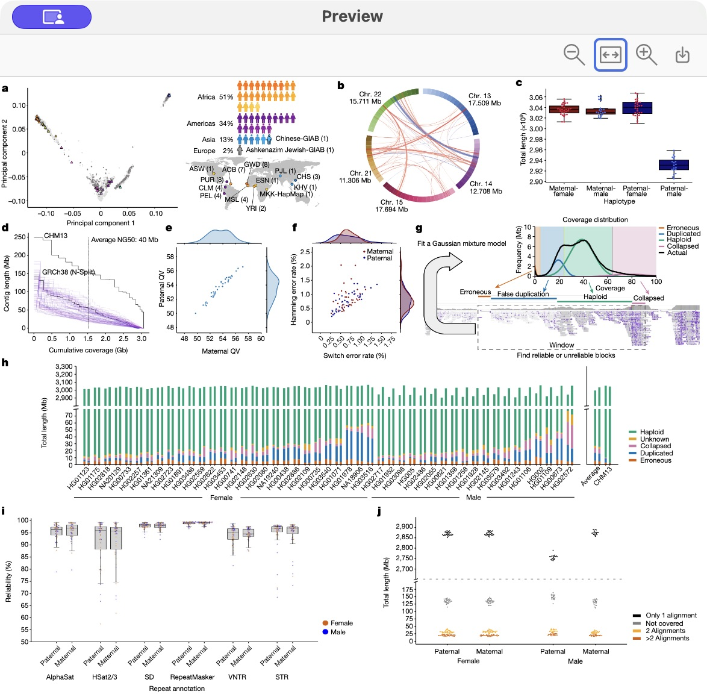
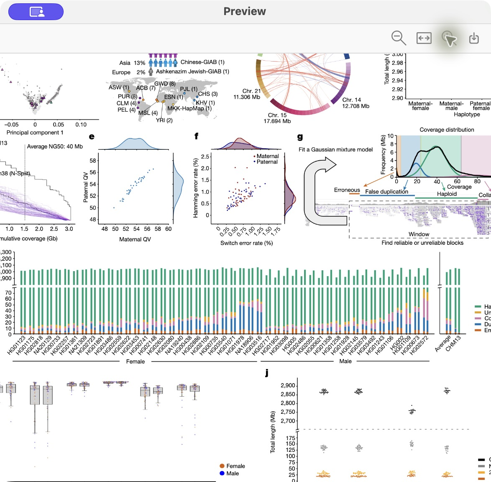

# 界面图廊

[返回首页](../README.md) · [macOS 安装](INSTALL.macOS.zh-CN.md) · [Windows 安装](INSTALL.Windows.zh-CN.md) · [Zotero 完整指南](ZOTERO.zh-CN.md) · [翻译后端配置](TRANSLATION-BACKENDS.zh-CN.md)

Ask for GPT 提供 Windows 和 macOS 两个版本，把查词、翻译和提问放在当前阅读环境中。下面按使用流程查看 macOS版的阅读与写作界面，Windows版的安装与功能范围见[Windows 指南](INSTALL.Windows.zh-CN.md)。

## 全功能概览 · English narration

[播放 / 下载完整视频](https://github.com/Woyekun-cell/Ask-for-GPT/releases/download/v1.1.55/Ask-for-GPT-feature-overview-en.mp4) · [English transcript](demo-source/feature-overview-en.md) · [素材与版本记录](images/feature-overview-provenance.json)

视频按完整使用流程介绍查词、Local/GPT/Explain、选段提问、Chrome 网页翻译、Zotero 原文/译文/对照、词组对应、原生标注、阅读控制、图表预览与写作建议。英文旁白为本机 Samantha 合成。镜头中的 `Earlier Zotero capture` 为此前真实宿主截图；`Native interface preview` 为注入演示数据的原生视图渲染；`Feature guide` 用于说明问答和 Chrome 流程。素材身份始终保留，未将预览当作实际 AI 结果。

Zotero 较早截图使用 Liao et al., [A draft human pangenome reference](https://doi.org/10.1038/s41586-023-05896-x), Nature (2023), [CC BY 4.0](https://creativecommons.org/licenses/by/4.0/)；右侧为机器译文及排版改编。当前阅读操作片段沿用下方 1.1.55 实录及论文署名。完整视频为 macOS 产品介绍，Windows 下载与验证范围仍见独立指南。Apple Local 翻译需受支持的 macOS 与系统语言资源；AI 功能使用个人 Codex 连接。

## 1.1.55 阅读更新短片 · English narration

[播放 / 下载 MP4](https://github.com/Woyekun-cell/Ask-for-GPT/releases/download/v1.1.55/Ask-for-GPT-1.1.55-Zotero-demo-en.mp4) · [English transcript](demo-source/reader-demo-1.1.55-en.txt)

在 Zotero 的现有双语阅读页演示：棕褐/雪色同时应用到两栏，放大后用“适合宽度”恢复两栏，以及原文/译文/对照切换复用缓存。结束页数提示已收起，已有高亮仍可见。视频采用真实操作剪辑和本机 Samantha 英文合成旁白，不录入麦克风。

画面裁去系统菜单栏、其他文献标签、文库与 Dock。演示论文为 Logsdon et al., [Long-read human genome sequencing and its applications](https://doi.org/10.1038/s41576-020-0236-x), Nature Reviews Genetics (2020)；论文与出版物标识权利归其权利人。中文为机器译文。此处仅演示软件阅读界面，不分发论文 PDF。当前已缓存文献第一页的显示验证，不代表整篇语义对应全部成功，也不代表 Windows 桌面验收。

## 在 Zotero 里双语读论文

*Zotero 双语阅读 · Liao 等，[A draft human pangenome reference](https://doi.org/10.1038/s41586-023-05896-x)（Nature, 2023；[CC BY 4.0](https://creativecommons.org/licenses/by/4.0/)）。右侧为 Ask for GPT 生成的中文机器译文与排版。*

右侧选择当前页或整篇、翻译方向和显示方式，然后开始翻译。页面仍留在原来的 Zotero 标签中，适合先处理摘要或方法页，确认需要细读后再继续全文。

## 随手查词和翻译

选中一个词，按 `Option+D`，先查本地词典的音标、词性和释义。读一段文字时，**Local** 使用 macOS 的 Apple 本机翻译；主动点击 **GPT** 精译当前选段，或用 **Explain** 理清选段中的术语、逻辑和限定条件。

小窗可展开原文，结果支持选中后系统复制；任务可以停止、重试。方向提供 **EN→中 / 中→EN / Auto**，其中 Auto 自动识别源语言后译成中文。没有选区时可在 **Paste text** 中粘贴并点击 **Translate**；**Ask GPT** 把当前选段带入问答，继续追问。

## 原文、译文与对照

用译文视图连续阅读，遇到需要核对的术语或公式，再切换原文或对照。后台处理多页时，进度显示在侧栏，原始页面仍可阅读。

## 从任意一侧核对词组

*英文 “pangenome” 与中文“泛基因组”同时显示对应选区。原生面板中的八色、高亮和下划线入口真实可见；此次仅划词和展开面板，未保存新标注。*

在英文侧划选词语，可以查看中文对应；从中文侧划选，也可以回看英文表达。选区和语义单位结合，帮助核对专业词、动词搭配及修饰关系。

## 手动选择颜色，留下阅读记录

原生八色浮层保留 Zotero 熟悉的操作。只划选时可以临时核对，选择颜色后保存高亮或下划线。译文侧的标注关联原 PDF，并保留译文摘录；之后在 Zotero 标注列表继续写评论、改色和定位，重开文献时沿着原有标记接着读。

## 调整两侧阅读位置

*原文 Fig. 1 在左侧，中文第一页保留在右侧。论文来源同上。*

连续阅读时让两侧联动；查阅其他段落时切为独立。需要重新对齐字号，可以在更多菜单同步大小，或使用缩小、适合宽度、放大。按住 **Option** 单击段落，可以聚焦正在看的内容。本页/整份、停止和重试也放在这里。

## 按图表标题跳转

打开图表面板，按图题或表题查找位置。先选择左侧或右侧，再跳转；另一侧可以保留在当前段落，便于边看图表边读结果。

单击论文图片，或悬停后按 **空格**，在独立预览窗口里放大看标签、适合窗口或导出 PNG。侧栏的 **悬停释义**便于就地查词，**重开时提示阅读位置**帮助下次回来接着读。已有与源文献匹配的完整本地译本时，可复用结果，也可作为普通 PDF 附件管理。

## 独立放大图片并导出 PNG

*单击原文物理第 3 页（印刷页 314）的 Fig. 1 后打开的真实窗口。工具栏为缩小、适合窗口、放大和 PNG 导出。*

*点击 Zoom In 后放大查看局部，点击 Fit 可恢复完整图片。此图保留原始窗口截图，未另行裁切或拼图。*

*通过原生保存面板实际导出 PNG，窗口显示 “PNG exported”。导出检查文件仅存放于本次工作目录，原 PDF 和 Zotero 文献记录未改动。*

## 在 Chrome、Preview 和 WPS 中继续阅读

Chrome 网页在原段落旁插入译文，优先处理视口附近内容，向下阅读时继续处理后面的段落；底部可切换方向、颜色、暂停、继续或恢复原文。Chrome PDF 单独提供 **Page / Document** 范围、原文/译文/对照、进度和 **Cancel**。

macOS 的 **PDF · 原阅读器**菜单把生成的 PDF 交回 Preview 或 WPS 打开，支持本页或整份、只看译文或原文＋译文、两个翻译方向，以及最近译文、恢复原文和取消翻译。

## 写作时查看一处修改

建议卡展示原文与拟替换内容。你可以替换、忽略或加入词典；处理正文前先看清修改。Word 和 WPS 的具体功能范围见安装手册。

## 设置模型与快捷键

这张设置图保留历史版本的原生界面预览。macOS 1.1.55 在 **CLI 路径**中配置个人 Codex，并使用 **保存并连接**；历史图中的 API / Claude 可选入口不属于本次 Mac 安装包。版本范围见[翻译后端说明](TRANSLATION-BACKENDS.zh-CN.md)。

## 图像来源

文字说明随当前功能更新，版本见[Zotero 指南](ZOTERO.zh-CN.md)。下列图片保留原拍摄或制作版本，按各自来源记录区分。

双语阅读实机图取自 Liao 等的 [A draft human pangenome reference](https://doi.org/10.1038/s41586-023-05896-x)（Nature, 2023；[CC BY 4.0](https://creativecommons.org/licenses/by/4.0/)），中文译文与排版由 Ask for GPT 生成。原文和许可见[官方 PMC 全文](https://pmc.ncbi.nlm.nih.gov/articles/PMC10172123/)；截图环境见[实机图来源](images/zotero/live-provenance.json)。

本页 PDF 图全部来自真实文献窗口。此次补拍了双向划词与原生八色面板、独立图片预览、放大及导出成功状态。未为截图保存新标注；悬停释义弹窗与重开位置提示仍未补拍。截图环境为 macOS / Ask for GPT 1.1.37 / Zotero 9.0.6 / 插件 0.3.76，显示已有的单页中文译本，不代表整篇翻译验收。主程序与写作图保留原来源记录：[主程序图来源](images/provenance.json)。安装包和版本信息见[发行页](https://github.com/Woyekun-cell/Ask-for-GPT/releases/tag/v1.1.38)。
