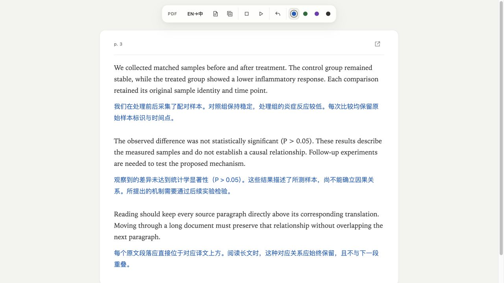

# 界面图廊

Ask for GPT 的界面按使用场景展示。演示文字由本项目编写，不含用户文献库、研究文件或私人对话。界面图用于介绍布局与入口；宿主操作、模型结果和新机器安装分别验证。

## 1. 划词翻译

全局快捷键打开紧凑翻译窗。方向选择、结果配色和后续提问集中在选段附近。图为当前源码视图的本机原生渲染，状态由自有样例注入。

## 2. 段落对照阅读

原文在上、译文在下。滚动时保持段落顺序。图为 2026-10-16 保存的段落阅读演示，使用合成文本；它展示段落阅读界面，不展示最新 Zotero 原生 PDF 双视图。

Chrome 网页使用原页面插入译文的方式。PDF 另走保版流程，可选择本页或整篇，在 Zotero 原标签切换原文、译文、对照；原生标注与双向词组映射需要真实文档的坐标与映射数据。

## 3. 写作建议

原文与建议并列呈现，用户选择替换、忽略或加入词典。图为当前源码原生建议卡的演示渲染；不代表本次执行了 Word/WPS 的替换或撤销。

## 4. 设置

集中配置翻译与提问、CLI 路径、模型、推理强度、自动划词及快捷键。图中为演示设置；模型权限和实际连接取决于本机环境。

## 图像来源与复核

[provenance.json](images/provenance.json)记录每张图的渲染来源和 SHA-256。原生渲染入口随源码保留，段落阅读图按历史演示标记。图中示例文本是界面素材，不是研究结果。
