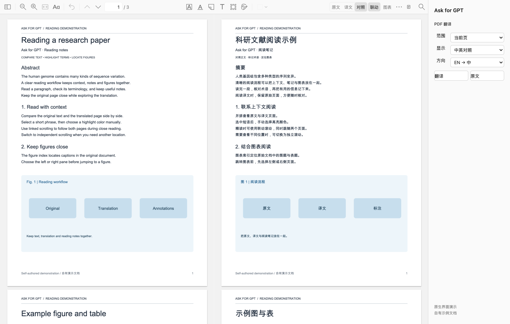

# 在 Zotero 中读论文

[返回首页](../README.md) · [安装手册](HANDBOOK.zh-CN.md#4-安装阅读插件) · [翻译后端配置](TRANSLATION-BACKENDS.zh-CN.md) · [界面图廊](GALLERY.md)

Ask for GPT 把 PDF 翻译、双语对照和词语标注放进 Zotero 原有的阅读标签。你可以先翻译眼前的一页，判断文章是否值得细读，再处理整篇；阅读时在原文、译文和对照之间切换，沿用 Zotero 的选区、颜色浮层和标注列表。

这份指南按实际读一篇论文的顺序介绍操作。当前下载版为 Ask for GPT 1.0.85 / Zotero 插件 0.3.27；下文按中文界面的阅读流程说明，既有实机检查范围列在文末。

*原生界面演示，使用自有示例内容。下文各图用于说明入口和阅读方式；图像来源见[界面图廊](GALLERY.md)。*

## 1. 打开文献，从当前页开始

先启动 Ask for GPT，再在 Zotero 打开一份 PDF 附件。在右侧原生侧栏找到 **PDF 翻译**，设置三个选项：

| 选项 | 选择方式 |
| --- | --- |
| **范围** | **当前页**适合先读摘要、方法或某一页结果；**整篇**适合连续精读 |
| **显示** | **译文**集中读翻译；**中英对照**同时查看两种语言 |
| **方向** | 英文论文选 **EN → 中**；中文内容选 **中 → EN** |

选好后点击 **翻译**。侧栏会依次显示准备、翻译、排版和加载状态；处理多页时，还会显示已完成页数与总页数。

首次使用，建议先翻译一页。这样可以检查这篇 PDF 的正文提取、术语与版面，再决定是否翻译全文。确认需要继续后，把范围改为 **整篇**，再次点击 **翻译**即可。

也可以在 PDF 标签按 `⌥⇧X`（Option+Shift+X）快速进入翻译；首次使用这个入口默认处理当前页。已有翻译会话时，同一快捷键可在原文与上次译文视图之间切换。需要明确选择范围、方向时，使用右侧 **PDF 翻译**面板更直接。

尚未安装插件时，在 Ask for GPT 菜单栏打开 **页面内翻译…**，点击 **Zotero 插件文件**，再通过 Zotero 的插件管理界面从文件安装。主程序、PDF 运行环境和插件的完整准备步骤见[安装手册](HANDBOOK.zh-CN.md)。

翻译默认使用 Codex。若在主程序设置里填写 **翻译配置文件**，PDF 正文与句词映射会跟随这份 API / Claude Code 配置，Zotero 内的阅读和标注操作保持相同。可选接入的字段和验证状态见[翻译后端配置](TRANSLATION-BACKENDS.zh-CN.md)。

## 2. 在原文、译文和对照之间切换

翻译界面在 Zotero 顶部工具栏提供 **原文 / 译文 / 对照**三个按钮。它们适合不同的阅读节奏：

- **原文**：回到原 PDF，核对术语、公式、图注或某一句的表述。
- **译文**：用完整阅读区域连续读翻译，适合先把段落意思读通。
- **对照**：左侧原文、右侧译文，适合逐句核对、精读与做笔记。

*同一篇 PDF 的阅读视图演示。右栏的“中英对照”对应顶部工具栏的“对照”。*

PDF 翻译会保留页面的布局关系，把译文重新排入页面。图像、矢量内容和正文仍放在各自的页面位置，读到一段结果时可以继续参照旁边的图表。对照视图使用两个原生 PDF 阅读窗格，正文可以选择和复制。

完成翻译后，切换这三种视图会复用已有结果。点击 **原文**也可以在翻译任务运行时继续阅读，任务会在后台进行；再次点击 **译文**或 **对照**查看结果。

## 3. 选中一个词，查看另一种语言的对应表达

在 **对照**视图中，可以从任意一侧选择词或短语。原文侧划选后，译文侧会显示已建立的对应选区；从译文侧划选，也可以回看原文中相应的表达。这对于核对专业术语、动词搭配和句中修饰关系很实用。

*双向词组选择演示。对应范围取决于这一段已建立的语义与文字位置映射。*

操作时可以按以下顺序：

1. 点击顶部 **对照**。
2. 在左侧原文或右侧译文拖选需要核对的词语。
3. 查看另一侧出现的对应选区，再结合上下文判断用词。
4. 需要留存时，在 Zotero 原生浮层中选择颜色；只想核对时，点空白处取消选择即可。

两种语言的词长和顺序不同，对应范围会按词语的语义单位处理。例如，从中文词语中选取一部分，在已有可靠对应关系时，可以关联到另一侧完整的英文单词；保存后仍保留中文实际划选范围。这个处理尤其适合中文选区边界与英文词边界不一致的情况。

译文选择和普通复制可以先进行。页面上的词语对应在需要时另行准备，顶部的标注状态图标会提示 **正在准备词语对应，可继续阅读**。若准备失败，可重新划词，或使用更多菜单里的 **▶（重试）**。已有 PDF 译本会保留，词语对应准备与 PDF 翻译分开复用。

## 4. 用 Zotero 原生八色浮层保存标注

选择正文后会出现 Zotero 自己的颜色浮层，沿用原生八种颜色。普通文本划选只用于选择和核对；由你点击颜色，才创建相应标注。因此，查一个词或复制一句话时，可以继续保持阅读页面整洁。

*颜色浮层与保存后显示演示。具体保存动作由 Zotero 原生界面完成。*

一个常用流程是：先在中文译文里选中需要记住的术语，查看英文对应，再选一种颜色保存。插件把这条标注关联到原 PDF 的位置，并在标注内容中保留相应的译文摘录。随后可以在 Zotero 标注列表中继续添加评论、调整颜色或定位。

保存后的标注可以在原文与译文侧显示。切回 **原文**，再进入 **对照**时，已有的词语标注会按对应关系重新显示，便于之后继续精读。同一篇文献的阅读进度和标注仍沿用原附件，译本作为本机派生结果使用。

如果只想临时对照词义，完成划选后直接取消选择即可。需要形成正式阅读记录时，再使用颜色和评论整理自己的问题、证据与结论。

## 5. 联动滚动与独立阅读

对照视图默认使用 **联动**。在任意一侧正常滚动，另一侧跟随相应页面位置，适合从头顺着文章读下去。你可以从英文侧带动中文侧，也可以从中文侧带动英文侧。

点击 **联动**后，按钮变为 **独立**。此时可以把一侧留在当前段落，另一侧单独向前或向后查阅。例如，左侧保留原文方法段，右侧翻到前文核对术语；或者一侧看图，另一侧读相关结果。

准备恢复连续阅读时，先在要继续读的一侧操作，再点击 **独立**恢复 **联动**，另一侧会以当前侧的位置重新对齐。

*阅读工具演示。顶部保留常用按钮，范围、缩放、停止和重试放在“⋯”菜单。*

两侧阅读字号看起来不同，或某一侧为了查看细节而单独放大后，可以打开 **⋯ → 同步大小**。它会把另一侧的缩放比例调整到当前侧，方便重新对照。菜单里的 **− / ↔ / +** 分别用于缩小、适合宽度和放大。

只翻译当前页时，原文仍可继续翻到其他页。当原文侧进入尚无译文的页面，界面会提示 **本页尚无译文**，并切到 **独立**状态。可以先读原文，再为新页面选择 **本页**翻译，或改为处理整篇。

## 6. 从图表目录跳转，同时保留另一侧的位置

顶部的 **图表**按钮打开 **图表定位**面板。面板从 PDF 的可提取图题、表题中整理索引，显示图表编号、所在页和标题摘录。读结果时，可以直接查找 `Fig. 3` 或 `Table 1`，减少来回翻页。

*图表导航演示。面板中的页数为 PDF 物理页次，可能与期刊印刷页码不同。*

使用方式：

1. 点击 **图表**，等待标题索引读取完成。
2. 选择 **左侧**或 **右侧**，确定要移动哪一侧。
3. 点击图表条目，所选窗格跳到对应位置；另一侧保留当前阅读位置。
4. 看完图表后，可以继续独立浏览，或点击顶部 **独立**恢复联动。

图表跳转会主动切为独立滚动，很适合“一边看图，一边读结果”的场景。只翻译了一页时，右侧仅能跳转到已有译文的页面，其他条目会呈灰色；左侧原文可访问原 PDF 中的图表。整篇翻译后，两侧可以使用相应全文范围。

图表索引会在翻译准备期间开始读取，同一 PDF 阅读会话里再次打开面板可复用读取结果。索引中遇到图在前页、图注在后页且有明确指示的情况，会同时展示说明页信息。

## 7. “⋯”菜单里还有哪些操作

顶部工具栏保留阅读时最常用的切换与导航。点击 **⋯**，可以找到以下操作：

| 菜单项 | 用途 |
| --- | --- |
| **本页** | 翻译当前看到的 PDF 页面 |
| **整份** | 处理整份 PDF；对应右侧“范围”中的“整篇” |
| **■（停止）** | 停止当前文献正在运行的翻译请求 |
| **▶（重试）** | 重试处理；已有译本且当前页词语对应未准备好时，优先重试词语对应 |
| **− / ↔ / +** | 缩小、适合宽度、放大当前阅读侧 |
| **同步大小** | 在对照视图中，把另一侧缩放比例调整到当前侧 |
| **EN→中 / 中→EN** | 切换翻译方向，并按当前范围重新处理 |

顶部菜单使用 **本页 / 整份**，右侧面板使用 **当前页 / 整篇**，分别是同一范围的快捷入口和完整设置入口。方向按钮会启动对应方向的处理，使用前先确认当前范围。

## 8. 后台任务与缓存复用

每个 PDF 阅读标签保留自己的翻译状态和任务。开始处理一篇论文后，可以切换到另一篇文献，或切回原文继续读；后台任务会继续运行。返回原标签时，再加载这一篇的译文。

当前最多同时运行 **两篇文档任务**。每篇的停止操作只作用于自己的任务，方便在比较两篇论文时分别控制进度。切换标签可以继续处理；关闭对应阅读标签、退出 Zotero 或退出相关服务会结束该阅读会话，未完成的任务需要重新发起。

完成译本保存在本机，之后再次请求同一内容时会检查源文件内容、页范围、语言方向、翻译版本与后端配置摘要，匹配后直接复用。已有整篇译本时，还可以派生相应的本页结果。切换 **原文 / 译文 / 对照**也会复用已经加载的译文，无需为显示方式重新翻译。

完成译本长期保留。未完成、失败或取消任务的临时目录才按独立规则清理，当前上限为 64 项、7 天和 768 MiB。图表标题索引保留在当前 PDF 会话中，其复用范围与完成译本不同。

## 9. 建议的精读节奏

先打开摘要或关键结果页，用 **当前页 + 中英对照**快速判断论文是否相关。确定要读后，再处理 **整篇**，顺着对照视图阅读。

遇到术语，直接在任意一侧划选，核对另一种语言的表达；值得留下的内容再手动选色。读到结果引用的图表，打开 **图表**，把一侧跳到图表，另一侧保留结果段。图看完后恢复 **联动**，继续下一段。

需要复核原句时随时点 **原文**；想先读通一节时切到 **译文**。这些阅读方式可以围绕同一篇文献反复切换，已有翻译和标注继续使用。

## 10. 使用范围与当前验证

以下条件会直接影响阅读体验，使用前集中了解即可：

- **文档类型**：当前流程面向有可提取文字层的 PDF。扫描件需要先完成 OCR；图片内部文字保留原样。复杂竖排图内文字可能无法建立可靠的词语对应。
- **词语对应**：双向对应与译文侧标注依赖已建立的精确映射。暂时无法可靠匹配的选区会给出提示；可以稍后重试，或切回原文标注。插件不会把整句当作缺失词组的对应结果。
- **图表索引**：索引依据可提取的图题和表题定位。标题无法提取、写法特殊或只存在于图片中时，条目可能缺失；仍可使用 Zotero 原有页码导航。索引页次按 PDF 物理页计算。
- **数据流**：PDF 提取与排版在本机进行；翻译及句词语义对应向当前翻译配置的模型服务提交相应文字和必要上下文，默认使用 Codex。配置 API 后，请求与费用归入相应服务账户。应使用有权交由该服务处理的文献。原 PDF 文件不被覆盖；手动保存的 Zotero 标注会写入相应附件的标注记录。
- **结果核对**：引用译文前检查术语、数字、公式和原意。页面布局保留、译文准确性、词语对应是需要分别检查的结果。
- **已验证范围**：1.0.84 / 插件 0.3.24 的本机检查覆盖原生八色浮层、英中双向词级选择、手动保存及重建对照视图后的显示、双向滚动和“同步大小”。图表导航另经多篇 PDF 标题索引与本机界面检查。物理修饰键滚轮手势、实际显示帧率和新机器整套安装尚未完成相同范围的验收。

## 源码入口

文档中的功能可从这些文件继续查看。演示图的制作方式与内容来源见[界面图廊](GALLERY.md)。

| 功能 | 源码 |
| --- | --- |
| 右侧“PDF 翻译”面板、范围与方向 | [sidebar.js](../Integrations/Zotero/content/sidebar.js)、[中文界面文本](../Integrations/Zotero/locale/zh-CN/askgpt-inline.ftl) |
| 视图切换、后台任务、停止与重试 | [inline.js](../Integrations/Zotero/content/inline.js) |
| 原生双窗格、更多菜单、标注保存与缩放 | [pdf-native-view.js](../Integrations/Zotero/content/pdf-native-view.js) |
| 双向滚动与选区提示 | [pdf-scroll-sync.js](../Integrations/Zotero/content/pdf-scroll-sync.js)、[pdf-selection-link.js](../Integrations/Zotero/content/pdf-selection-link.js) |
| 图表标题索引与定位面板 | [pdf-figure-navigation.js](../Integrations/Zotero/content/pdf-figure-navigation.js)、[pdf-figure-panel.js](../Integrations/Zotero/content/pdf-figure-panel.js) |
| 任务并发、完成译本与范围复用 | [server.py](../Integrations/PDFLayout/server.py) |
